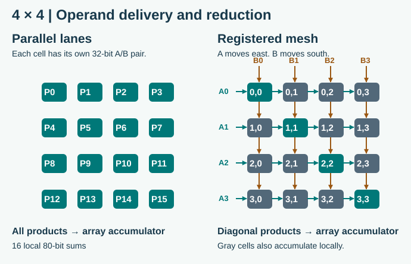
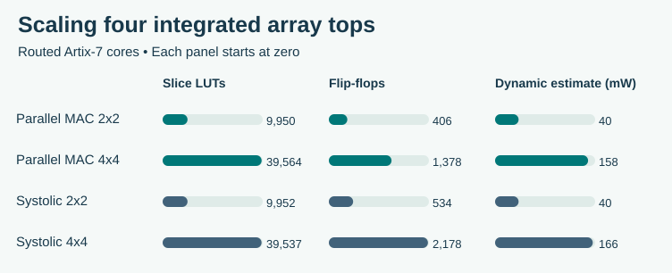
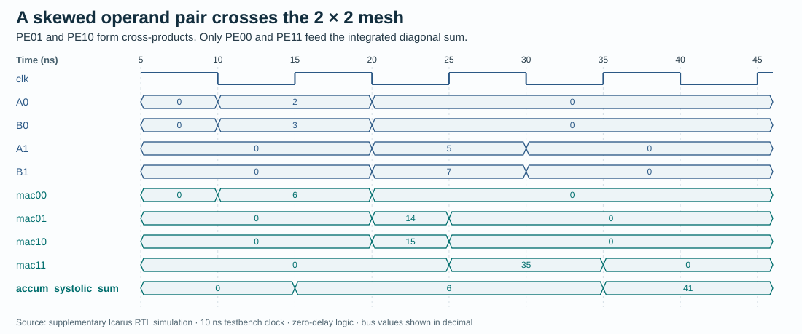
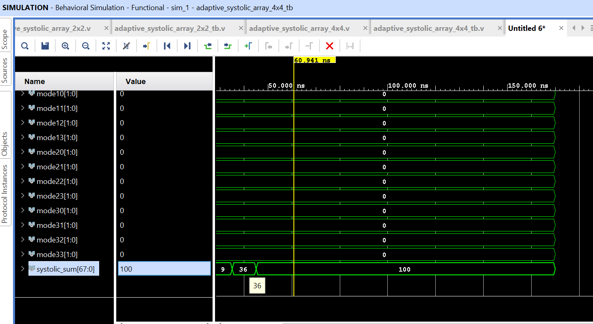
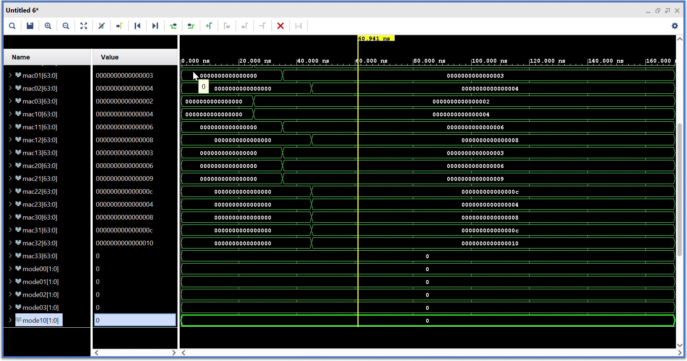

# Adaptive MAC Arrays and Systolic Arrays for DNN Accelerators

**One signed multiplier, two ways to move operands.** Four Verilog cores explore a practical accelerator design choice. A parallel array accepts an independent operand pair on every lane. A systolic array passes operands between neighbors, so fewer input buses can serve the same number of processing elements (PEs).

Both organizations scale from four to sixteen PEs. All four accumulator-integrated tops reproduced the signed dot product **3,995,709,172** on the same 784 input pairs in Vivado XSim. The 2×2 systolic test also reconstructs all four entries of a matrix product and exposes the matrix trace (sum of the diagonal entries) on the external result port. [Verification results](docs/verification.md)



## From a multiplier to a tile

Each lane detects the narrowest common signed width of its operands (INT8, INT16 or INT32), sign-extends them, performs radix-4 Booth recoding, reduces the partial products in a Wallace tree and merges the final vectors with a 64-bit carry-lookahead adder. The arrays use the **combinational product of Proposed Design I**, `cla_sum_out` from `adaptive_mac_top`, with separate 80-bit accumulation. Proposed Design II’s zero-aware gating stays in the dedicated MAC research repository.

A signed 80-bit register accumulates the product at each PE. A further 80-bit register produces the tile’s externally visible aggregate and makes the difference between the two organizations explicit. [Datapath, ports and clocking](docs/architecture.md)

| Integrated top | PEs | Operand buses | Per-cycle contribution to external sum | 784-pair feed |
|---|---:|---:|---|---:|
| `mac_array_2x2_accum_top` | 4 | 4 A + 4 B | Sum of all four products | 196 groups |
| `mac_array_4x4_accum_top` | 16 | 16 A + 16 B | Sum of all sixteen products | 49 groups |
| `systolic_array_2x2_accum_top` | 4 | 2 A + 2 B | Sum of two diagonal products | 392 groups + drain |
| `systolic_array_4x4_accum_top` | 16 | 4 A + 4 B | Sum of four diagonal products | 196 groups + drain |

The feed counts describe the benches’ schedules. They exclude reset, clear and drain edges. The mesh can also perform matrix multiplication by skewing the input rows and columns. Individual matrix entries are internal PE sums, accessible in RTL simulation. [Worked schedule](docs/dataflow.md)

## Implementation results

The original Vivado 2026.1 runs placed and routed each out-of-context core on **Artix-7 xc7a200tfbg676-2**, using an 83.333 ns clock and zero allowed DSPs. All four integrated designs used zero DSP blocks and zero bonded IOBs. Power values are vectorless tool estimates. [Eight routed configurations](results/comparisons/routed-ppa.csv)

| Integrated array | Slice LUTs | FFs | Reported data path (ns) | Setup slack (ns) | Dynamic / total (mW) |
|---|---:|---:|---:|---:|---:|
| Parallel 2×2 | 9,950 | 406 | 4.349 | +78.981 | 40 / 162 |
| Parallel 4×4 | 39,564 | 1,378 | 4.835 | +78.453 | 158 / 280 |
| Systolic 2×2 | 9,952 | 534 | 32.305 | +50.983 | 40 / 162 |
| Systolic 4×4 | 39,537 | 2,178 | 41.314 | +41.974 | 166 / 288 |



The 4×4 mesh uses 800 more FFs than the parallel tile. Its registered operand links allow values to travel across the tile. The parallel report’s selected path starts inside an accumulator and ends at an overflow flag. The mesh path starts at a forwarding register and crosses arithmetic before reaching a flag. These endpoints constrain what can be concluded about multiplier speed. [Baseline results, path endpoints and scaling](docs/performance-analysis.md)

## Simulation and demonstration



In this supplementary trace, the local PE sums reach 6, 14, 15 and 35. The output reaches **41**, the sum of the two diagonal cells. [Stimulus and trace](results/simulation/waveform.md)



The original XSim capture above shows the **base array’s** instantaneous sum reaching 100. The demonstration frame below shows individual PE products during the 4×4 walkthrough at 27.90 s.



## Reproduce the checks

```sh
python scripts/check_dataset.py
python scripts/run_original_golden.py
python scripts/run_xsim.py
```

The Python checks cover the paired memories and replay the original parallel-array golden model. The third command uses Vivado Simulator on PATH. It copies the source and memory files into a new scratch directory, elaborates each integrated bench, and checks its terminal verdict. [Tool setup and routed implementation flow](docs/reproduction.md)

| Directory | Contents |
|---|---|
| `rtl/common` | Signed arithmetic, PE forwarding, accumulator |
| `rtl/mac_array`, `rtl/systolic_array` | Fixed 2×2 and 4×4 base arrays and integrated tops |
| `testbench`, `datasets` | Original Verilog benches and paired hexadecimal stimulus |
| `scripts`, `constraints` | Supplemental reproduction commands and OOC clock |
| `results`, `assets` | Simulation checkpoints, routed figures, diagrams and demo still |

## Scope and attribution

These tiles exercise dot products and matrix tiles relevant to dense DNN layers. The RTL exposes scalar operand buses and a scalar aggregate. An external controller supplies the data schedule. Practical integration would require a memory interface, backpressure that also controls operand forwarding, and a way to read matrix entries in hardware. The current tests establish arithmetic checkpoints for the supplied workloads. They do not measure end-to-end inference accuracy or board energy. [Coverage and limitations](docs/verification.md)

## Academic Project & Acknowledgments

- **Lead Developer, Primary Technical Contributor & Repository Maintainer**: **Likhith B** ([LikhithB05](https://github.com/LikhithB05)) — hardware architecture design, Verilog RTL implementation, 2×2 and 4×4 parallel MAC array development, 2×2 and 4×4 systolic array development, 80-bit accumulator integration, functional verification and simulation, hardware performance/scalability analysis, and technical documentation.
- **Academic Team**: Undertaken as an academic Major project in the Department of Electronics and Communication Engineering, **JSS Academy of Technical Education, Bengaluru** (affiliated with **Visvesvaraya Technological University (VTU)**, Academic Year **2026–2027**), crediting the original project team (**Likhith B**, **Ananya S**, **Apoorva Sheshadri**, **K. S. Sindhura**) and academic guide **Mrs. Sunita L. Shirahatti** *(Assistant Professor, Dept. of ECE)*.

Detailed attribution and licensing status are recorded in [AUTHORS.md](AUTHORS.md).
