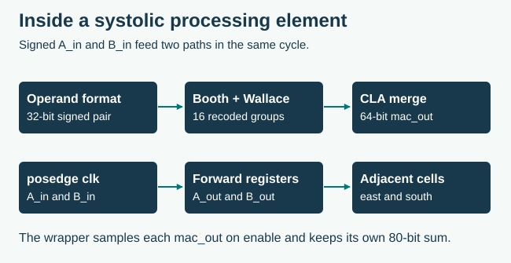

# PE, hierarchy and interface



The two fixed-size parallel base arrays instantiate 4 or 16 copies of `adaptive_mac_top` directly. Each sees its own 32-bit signed A and B and produces one 64-bit result. The systolic base arrays instantiate 4 or 16 `adaptive_processing_element` blocks, each wrapping the same MAC. A PE presents its current A and B to that MAC, and separately registers them as A_out and B_out for its right and lower neighbors. No partial sum moves between PEs.

```text
*_accum_top
  ├─ adaptive_mac_array_{2x2,4x4} → adaptive_mac_top
  │  or adaptive_systolic_array_{2x2,4x4} → adaptive_processing_element → adaptive_mac_top
  └─ adaptive_precision_accumulator × (PE count + 1)

adaptive_mac_top
  mode_controller → operand_formatter → 16 × booth_encoder_r4
    → 16 × partial_product_generator → wallace_tree_32 (csa)
    → cla_64bit (cla_4bit) → cla_sum_out
  acc → legacy internal accumulation outputs (unused by wrappers)
```

Mode 00 requires both operands to fit signed 8 bits. Mode 01 covers the remaining pairs that fit signed 16 bits. Mode 10 covers the remainder. The formatter sign-extends the narrow slices. The Booth logic forms overlapping three-bit windows with zero padding at the least-significant end. The generator selects 0, ±A or ±2A, shifted by twice the group index. The RTL instantiates all sixteen recoders. At the Wallace-tree input, mode selects the lowest four, eight or all sixteen partial products and masks the remaining inputs to zero. There is no explicit zero-detection skip control in the selected array cores.

| Interface | Parallel N×N | Systolic N×N |
|---|---|---|
| Operand ports, signed 32-bit | A0/B0 through A(N²–1)/B(N²–1) | A0…A(N–1) feed rows, B0…B(N–1) feed columns |
| Common controls | clk, reset, clear, enable | Same controls |
| Result port, signed 80-bit | accum_dot_product_out | accum_systolic_sum |
| Status | valid_out, overflow_flag | Same outputs |
| External port bits, N=2 / N=4 | 342 / 1,110 | 214 / 342 |
| Product / reduction input width, N=2 | 64 / 66 | 64 / 66 |
| Product / reduction input width, N=4 | 64 / 68 | 64 / 68 |

The width calculation is 32 × operand-port count + 4 control bits + 80 result bits + 2 status bits. Internal mode, individual sums and instantaneous reductions are visible hierarchically in RTL simulation. External interface width alone cannot establish that a device can route or legally assign the pins.

Each wrapper maintains one local sum per PE and one array sum. The accumulator sign-extends each input to 80 bits, adds modulo 2⁸⁰ and sets a sticky flag when same-sign operands yield an opposite-sign result. The exported flag ORs local and array flags. Active-high reset is asynchronous in the actual sensitivity list. On a rising edge, synchronous clear takes priority over enable. An enabled addition asserts valid_out, and an idle edge clears valid_out while holding data. Clear resets the flags. Forwarding registers update on every rising edge irrespective of enable and clear. A paused accumulator therefore cannot be treated as a stalled mesh.

The earlier adaptive core contains a legacy 65-bit accumulator whose enable is unconnected in this source variant. XSim flags the omitted port. The arrays consume the independently driven CLA product. Using the internal legacy accumulator output as the array’s reference would change the design under test.
