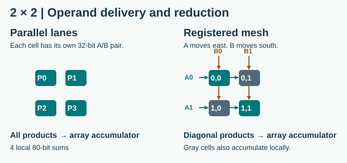

# Scheduling operand motion

For the parallel array, lane k receives A[k] and B[k] directly. The enabled edge samples all lane products and adds their sum to the previous aggregate. Supplying new, stable operands each cycle allows a new group every enabled edge under a compatible external timing budget.

For the mesh, cell (i,j) sees row input A[i] from j clocks earlier and column input B[j] from i clocks earlier. Each enabled edge adds their product to local register (i,j). The aggregate sees only i=j. The base array separately exposes the sum across every current PE. The integrated wrapper does not feed that whole-grid sum into its temporal aggregate.

## A worked matrix tile

To accumulate C[i,j] = Σₖ A[i,k]B[k,j] across K inner products, issue A[i,k] at cycle k+i and B[k,j] at cycle k+j. Both reach PE(i,j) at cycle k+i+j. With zero padding, the last product is accumulated at indexed cycle K−1+2(N−1). This is a derived edge schedule for continuously enabled accumulation. For the 2×2 bench, A = [[1,2],[3,4]] and B = [[5,6],[7,8]].

| Issue cycle | A0, A1 | B0, B1 | Local products added, ordered 00, 01, 10, 11 |
|---:|---|---|---|
| 0 | 1, 0 | 5, 0 | 5, 0, 0, 0 |
| 1 | 2, 3 | 7, 6 | 14, 6, 15, 0 |
| 2 | 0, 4 | 0, 8 | 0, 16, 28, 18 |
| 3 | 0, 0 | 0, 0 | 0, 0, 0, 32 |
| Accumulated | | | **19, 22, 43, 50** |

The internal entries sum to 134. The external accumulator contains the trace, 19 + 50 = **69**. The 4×4 bench uses an identity matrix and a diagonal matrix with entries 10, 20, 30 and 40. Its assertions inspect the four diagonal registers and exported sum 100.

For a flat dot product the benches use another schedule. Inject matching A/B pairs on matching row and column indices at the same cycle. Each diagonal sees its own channel delayed by its index, so summing the diagonal across time reconstructs the input dot product. Non-diagonal PE products pair other input elements. The benches retain enable during zero-filled drain for two cycles (2×2) or four cycles (4×4).
